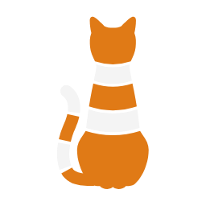

<div align="center">



# CopyCat Media Player

**A modern, hardware-accelerated desktop media player for Windows.**  
*Re-imagining classic media playback through a refined glassmorphic interface, zero-copy Direct Composition rendering, Web Audio DSP amplification, and native system integration.*

[](https://github.com/georgschneider96-collab/CopyCat-media-player/releases/latest)
[-blue?style=flat-square)](https://github.com/georgschneider96-collab/CopyCat-media-player)
[](https://www.electronjs.org/)
[](LICENSE)

</div>

---

## Overview

**CopyCat Media Player** is a standalone, frameless desktop media player engineered for performance, precision, and modern design aesthetics. Built from the ground up on Electron, HTML5 Video/Canvas, and the Web Audio API, CopyCat brings Juxtopposed’s viral *VLC After 25 Years* conceptual redesign to life with a bespoke cat iconography branding, ultra-responsive gesture drawers, zero-latency local HTTP control, and native Windows shell integration.

---

## Key Features

### 🎨 Refined Glassmorphic Interface
- **Frameless Acrylic Canvas**: Custom title bar with window snapping, smooth maximize/restore transitions, and fluid drag-down gestures from fullscreen mode.
- **Dynamic Accent System**: 9 built-in theme presets (*Traffic Cone Orange, Amber, Lime, Emerald, Cyan, Blue, Purple, Magenta, Rose*) powering coherent accents and tinted seekbar fills.
- **Context-Aware Drawers**: Edge-gesture side panels—Left Library Navigator and Right Queue / Bookmarks Drawer—that glide smoothly into view and automatically defer rendering calculations when collapsed.
- **Unobtrusive Controls**: Bottom playback bar, volume popovers, and settings auto-hide during video playback and restore instantly on mouse interaction.

### ⚡ Hardware-Accelerated Video Engine
- **Direct Composition Zero-Copy Passthrough**: Active video playback bypasses intermediate CSS filter graphs (`filter: none`), enabling Chromium’s Direct Composition swapchain to feed hardware-decoded video surfaces directly to the display with minimal GPU memory transfers.
- **Chromium GPU Acceleration**: Configured with dedicated hardware decode switches (`enable-accelerated-video-decode`, `enable-accelerated-mjpeg-decode`) for smooth 4K/60fps and high-bitrate playback.
- **Universal Format Demuxing**: Seamlessly plays standard HTML5 formats (`.mp4`, `.webm`) as well as extended media containers (`.mkv`, `.avi`, `.ts`, `.m2ts`, `.flv`, `.vob`, `.wmv`) through bundled background FFmpeg/FFprobe streaming services.

### 🔊 Studio-Grade Web Audio & Real-Time Visualizer
- **True 200% Volume Boost**: Powered by native Web Audio `GainNode` processing for authentic acoustic amplification beyond 100% without digital clipping.
- **Parametric Multi-Band Equalizer**: Built-in EQ presets (Flat, Bass Boost, Treble Boost, Vocal Clarity, Electronic, Rock) with real-time biquad filtering.
- **60fps Zero-Allocation Visualizer**: Real-time frequency spectrum visualizer engineered with pre-allocated typed arrays, cached color tokens, and cached 2D canvas contexts for 0ms garbage collection pauses.

### 💬 Precision Subtitle Engine
- **$O(\log N)$ Binary Search Matching**: Instantaneous cue synchronization across thousands of subtitle lines, eliminating frame drops during dense dialogue sequences.
- **Cue Equality Memoization**: Guards against redundant DOM reflows by updating the subtitle overlay only when active cue content changes.
- **Interactive Dialogue Timeline**: Displays subtitle cue density directly on the seekbar and provides on-the-fly subtitle delay synchronization ($\pm 50\text{ms}$).

### 🎯 Power-User Tools & Playback Controls
- **Live Hover Scrubbing**: Floating live thumbnail preview card with LRU frame caching for instant scrubbing precision.
- **Hold for 2.0x Speed**: Press and hold `Space` or long-press the video canvas to smoothly boost playback to 2.0x with an animated HUD badge; release to restore normal speed.
- **Stop After Current Episode (`E`)**: Complete the current file cleanly and stop playback automatically without advancing down the queue.
- **Automated Sleep Timer**: Configurable graceful sleep timer (15m to 120m) with live status readout.
- **Instant Boss Key (`F12`)**: Silences audio, pauses playback, exits fullscreen/PiP, and minimizes the window instantly.
- **Always-on-Top Picture-in-Picture (`P`)**: Native Windows TopMost enforcement via compiled C# helper for guaranteed screen priority over other applications.
- **Watched Episode Tracking**: Session-aware checkmarks and hover tags in the queue list to track series progress.

### 🪟 Native Windows Integration
- **Shell Associations**: Registers CopyCat as an official media viewer across 21 extensions (`.mp4`, `.mkv`, `.ts`, `.webm`, `.avi`, `.mov`, `.flac`, `.mp3`, `.opus`, etc.).
- **Windows Explorer Context Menu**: Right-click any media file or directory to "Play with CopyCat media player".
- **Taskbar Thumbnail Toolbar & SMTC**: Control playback directly from the Windows taskbar preview (Play/Pause, Next, Previous) and Windows System Media Transport Controls.

### 🤖 Local AI & Script Automation Bridge
- Hosts a high-performance local REST HTTP server on `127.0.0.1:4500` enabled with `TCP_NODELAY`.
- Enables external scripts, CLI utilities, and AI assistants (Antigravity, Gemini, Copilot, Cursor) to inspect playback state and control the player programmatically via JSON payloads (`/api/status`, `/api/control`).

---

## Keyboard Shortcuts

| Shortcut | Action |
| :--- | :--- |
| `Space` / `K` | Toggle Play / Pause *(Hold Space >220ms for 2.0x Speed)* |
| `F` / Double-Click | Toggle Fullscreen |
| `M` | Toggle Audio Mute |
| `Z` / `A` | **Cycle Aspect Ratio** *(Contain, Cover, Stretch, 16:9, 4:3, 21:9)* |
| `←` / `→` | Seek -5s / +5s *(Shift for ±15s, coalesced multi-tap)* |
| `↑` / `↓` | Volume +5% / -5% *(Boost up to 200%)* |
| `[` / `]` | Playback Speed -0.25x / +0.25x |
| `Tab` | Skip Intro / Outro / Segment *(Full Binge Mode available)* |
| `E` | Toggle "Stop After Current Episode" |
| `P` | Toggle Always-on-Top Picture-in-Picture (PiP) |
| `B` | Add Timestamp Bookmark |
| `S` / `Shift + S` | Capture & Save High-Resolution Video Snapshot |
| `F12` | **Boss Key**: Instant Mute, Pause & Minimize |
| `Ctrl + O` | Open Media File |
| `Ctrl + F` | Open Media Folder |
| `Ctrl + P` | Open Preferences & Themes |
| `Escape` | Close Popovers / Exit Fullscreen |

---

## Installation

### Option 1: Standalone Installer or Portable App (Recommended)
Download the latest pre-compiled binaries from the [GitHub Releases](https://github.com/georgschneider96-collab/CopyCat-media-player/releases/latest) page:
- **`CopyCat-media-player-Setup-x.x.x.exe`**: Complete Windows installer with file associations and desktop shortcut.
- **`CopyCat-media-player-x.x.x-portable.exe`**: Zero-install standalone executable.

### Option 2: Run from Source

#### Prerequisites
- [Node.js](https://nodejs.org/) (v18.0.0 or higher recommended)
- npm (bundled with Node.js)
- Windows 10 or 11 (64-bit)

#### Setup & Execution
```powershell
# Clone the repository
git clone https://github.com/georgschneider96-collab/CopyCat-media-player.git
cd CopyCat-media-player

# Install dependencies
npm install

# Start CopyCat Media Player
npm start
```

#### Compiling Production Binaries
```powershell
# Package standard setup installer and portable executable to dist/
npm run dist

# Package portable executable only
npm run dist:portable
```

---

## Architecture

```text
CopyCat Media Player/
├── package.json          # App manifest, dependencies, and electron-builder packaging config
├── main.js               # Electron Main Process: frameless window, IPC, hardware flags, HTTP bridge
├── preload.js            # Secure context bridge exposing window.vlcopycat API
├── AI_CONTEXT.md         # Deep technical specification & AI control schema guide
├── README.md             # Project documentation
├── assets/
│   ├── icon.ico          # Multi-resolution Windows application icon
│   ├── icon.png          # High-resolution raster logo
│   └── thumbar-*.png     # Windows taskbar thumbnail toolbar button icons
├── bin/
│   ├── ffmpeg.exe        # Bundled static FFmpeg media processor
│   ├── ffprobe.exe       # Bundled static FFprobe stream analyzer
│   ├── launcher.cs       # C# Win32 desktop session redirector source
│   ├── pip-helper.cs     # C# Win32 HWND TopMost enforcer source
│   ├── pip-helper.exe    # Compiled always-on-top PiP helper binary
│   ├── open_player.ps1   # PowerShell automation and session summoning script
│   └── register_associations.ps1 # Comprehensive Windows file type association setup
└── src/
    ├── index.html        # DOM layout: Titlebar, Video Canvas, Drawers, Seekbar, Dialogs
    ├── styles.css        # Glassmorphic CSS design system, CSS custom properties, animations
    ├── icons.js          # Crisp inline SVG vector iconography
    └── app.js            # Core playback state machine, Web Audio DSP, subtitle engine & event orchestration
```

---

## License

This project is licensed under the [MIT License](LICENSE).

---

<div align="center">
  <sub>Engineered with precision for modern media playback. Inspired by Juxtopposed's VLC redesign concept.</sub>
</div>
